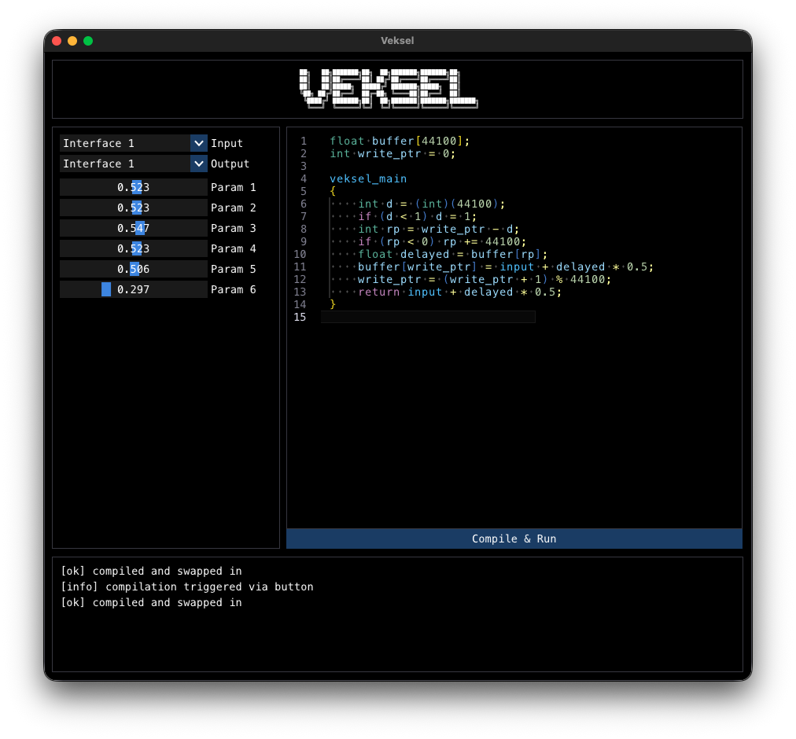

# Veksel

*Named after **Wechsel** (German for "change")*

Live-coded audio effects. Edit C in the window, press Compile, hear the change instantly.



## Using it

Your code goes in the editor. Write a function with the `veksel_main` macro that
takes `input` (the current mic sample) and returns the output sample:
```
veksel_main
{
    return input * 0.5f;
}
```

Press **Compile**. If it builds, the new code is swapped into the running stream.
If it doesn't, the errors show in the log and the previous plugin keeps playing.
You get access to `<math.h>`, `<stdlib.h>`, `<stdio.h>` and `M_PI`.


## How it works

Three threads, one job each:

- **main**: the ImGui window: editor, Compile button, log.
- **compiler**: runs clang, loads the resulting `.dylib`/`.so`, frees old plugins.
- **audio**: PortAudio callback, runs the plugin.

A new plugin goes from the compiler thread to the audio thread through a single
atomic pointer, and the old one is handed back to be unloaded on the compiler
thread. No locks, allocation or `dlclose` on the audio path. Output is checked
for NaN/inf and clamped to ±1 before it reaches the speakers.

## Rules for plugin code

`veksel_main` runs on the audio thread once per sample. Don't allocate, print,
lock, sleep or block. Keep it fast. Static variables work, but reset on every
reload.

## Limits

- Mono in, mono out (For now).
- A plugin that crashes (segfault) or never returns (infinite loop) takes the whole program down.
- Compiling blocks until clang finishes.
- Needs clang at `/usr/bin/clang`, PortAudio, GLFW, Dear ImGui and C++20.
- Your code isn't saved. Close the window and it's gone.

## TODO

- [ ] Survive a broken plugin, so run a test in a new process before
      loading, and dont load if it breaks.
- [ ] Save and load the editor text (currently lost on exit).
- [ ] Knobs and switches the plugin can read.
- [ ] Stereo plugins (`veksel_main_stereo`).
- [ ] Mark compile errors in the actual editor.
- [ ] Make cross platfrom.
