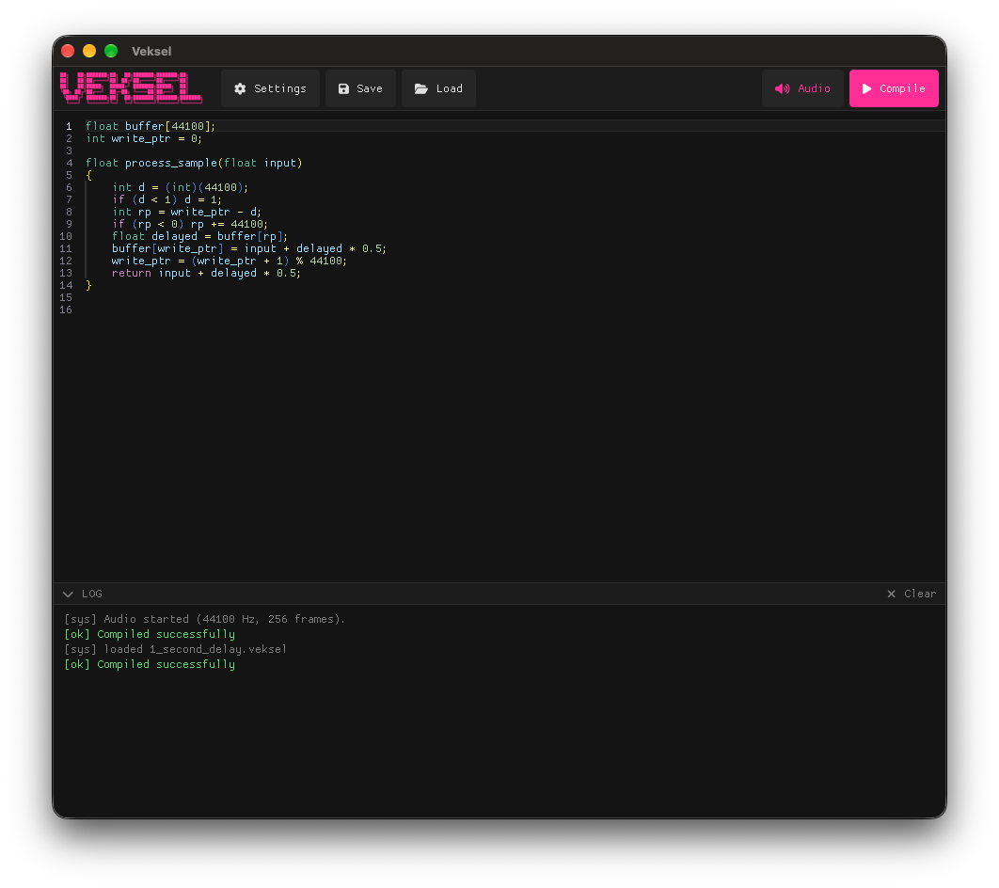
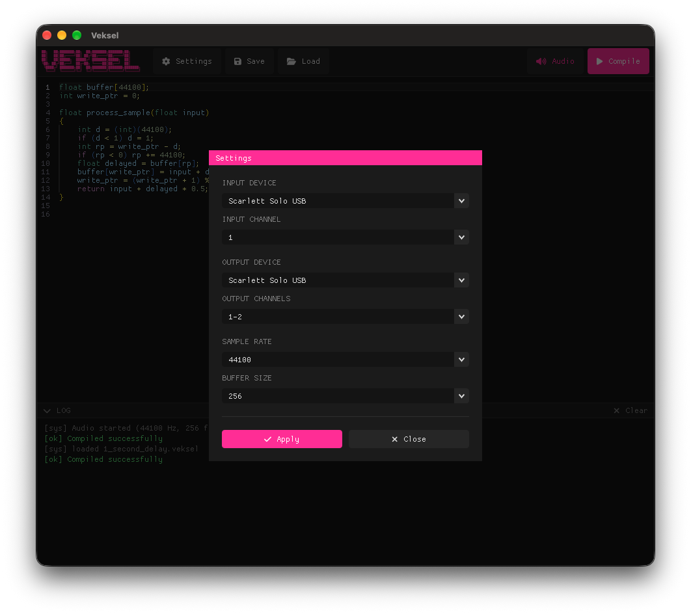
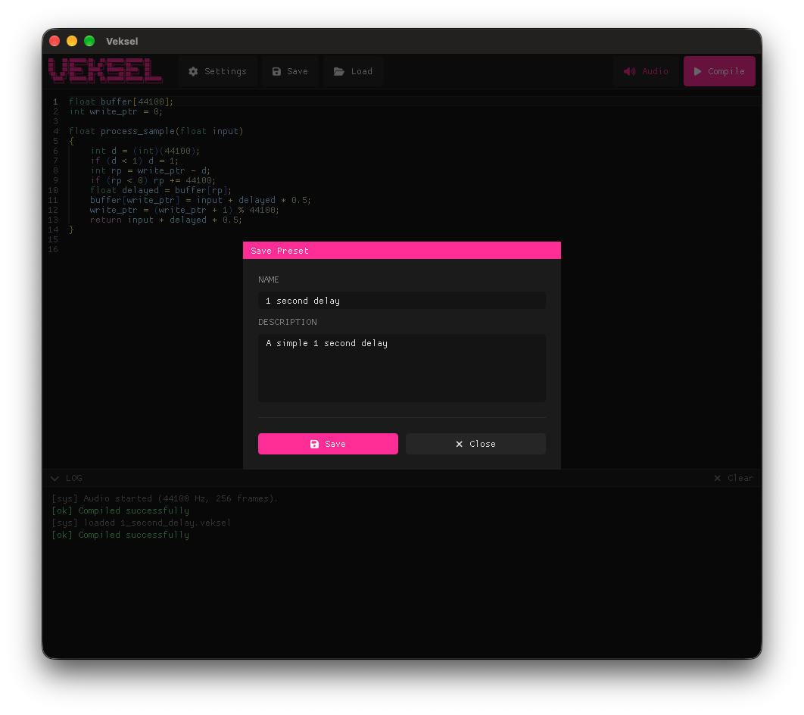
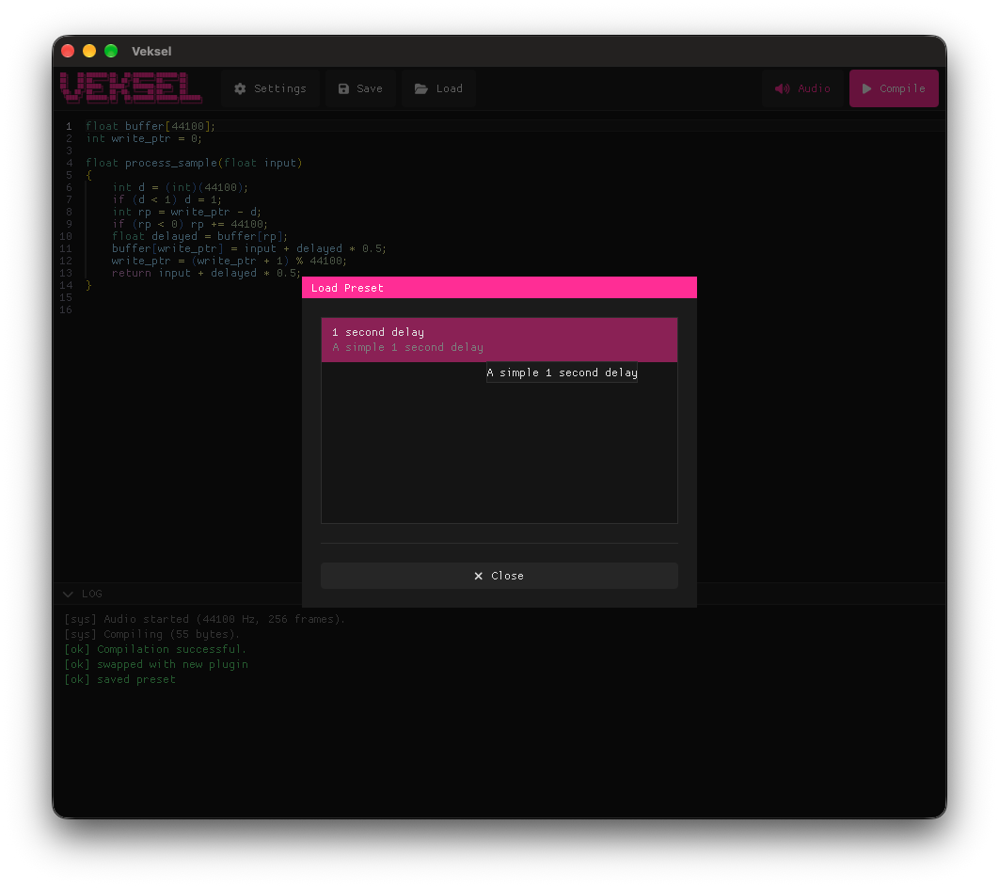

[](https://github.com/JoeKenyon/veksel/actions/workflows/main.yml)
# Veksel

*Named after **Wechsel** (German for "change")*

Live-coded audio effects. Edit C in the window, press Compile, hear the change instantly.



## Building

```
git clone --recursive https://github.com/JoeKenyon/veksel
cd veksel
cmake -B build -DCMAKE_BUILD_TYPE=Release
cmake --build build
./build/veksel
```

You need CMake 3.16+, a C++20 compiler and `make`. Everything else (GLFW, PortAudio,
Dear ImGui, TinyCC, the text editor) comes in as submodules, so there's nothing to
install and no clang needed. TinyCC is what compiles your code.

Tests use Catch2, which CMake downloads at configure time:
```
ctest --test-dir build --output-on-failure
```

## Using it

Your code goes in the editor. Write a `process_sample` function that takes `input`
(the current mic sample) and returns the output sample:
```c
float process_sample(float input)
{
    return input * 0.5f;
}
```

Press **Compile**. If it builds, the new code is swapped into the running stream.
If it doesn't, the errors show in the log with line numbers that match the editor,
and the previous plugin keeps playing.
You get access to `<math.h>`, `<stdlib.h>`, `<stdio.h>` and `M_PI`.

### Header buttons

- **Settings**: input device and channel, output device and channel pair, sample
  rate and buffer size. Apply restarts the stream with the new settings.
- **Save**: save the editor contents as a preset.
- **Load**: pick a saved preset.
- **Audio**: turn the audio stream on and off.
- **Compile**: compile the editor contents and hot-swap it in.

The log panel at the bottom can be collapsed with the bar above it. Errors show in
red and successes in green.

### Settings



### Saving presets

Give the preset a name and an optional multi-line description.



Presets are written to `presets/` (relative to where you launched Veksel) as
`<name>.veksel`. Spaces in the name become `_` and other odd characters are dropped.
The name and description are stored as comments at the top of the file, so a preset
is still plain C:
```c
// name: Plugin
// description: This is the description of the plugin

float process_sample(float input)
{
    ...
}
```
Saving with an existing name overwrites the old file.

### Loading presets

Presets are listed alphabetically with the first line of the description. Hover a
preset to see the full description. Clicking one loads it into the editor and compiles it.



## How it works

Three threads, one job each:

- **main**: the ImGui window: editor, buttons, settings, log.
- **compiler**: TinyCC compiles your C straight into executable memory on its own thread, so the UI stays responsive while it builds.
- **audio**: PortAudio callback, runs the plugin once per sample.

Plugins move between the compiler and audio threads through two lock-free slots,
`incoming` and `retired`:

1. The compiler thread finishes a plugin and publishes it to `incoming`. If an
   earlier plugin was never picked up, it is freed and replaced.
2. At the start of each audio block, the audio thread checks `incoming`. If a
   plugin is waiting and `retired` is empty, it takes the new plugin and puts the
   old one in `retired`. The swap happens between blocks, so it is never halfway
   through running the old plugin.
3. At the start of its next compile, the compiler thread frees whatever is in
   `retired`.

The audio thread never locks, allocates, logs or frees memory. The only mutex is
between the main thread and the compiler thread, for queuing source and shutdown.

## Rules for plugin code

`process_sample` runs on the audio thread once per sample. Don't allocate, print,
lock, sleep or block. Keep it fast. Static variables work, but reset on every
reload.

## Limits

- Mono in, mono out (for now). One input channel is read, and the output sample is copied to both channels of the output pair you pick.
- A plugin that crashes (segfault) or never returns (infinite loop) takes the whole program down.
- Plugins don't know the sample rate.
- TinyCC doesn't optimise, so plugin code runs slower than it would from clang with `-O2`.
- Only tried on macOS (Apple Silicon). Linux is untested and Windows isn't supported yet.
- Your code isn't saved for you. It starts from a passthrough every launch, so use Save.

## TODO

- [ ] Survive a broken plugin: run a test in a new process before loading, and don't load if it breaks.
- [ ] Expose the sample rate to plugins.
- [ ] Stereo plugins.
- [ ] Make it cross platform