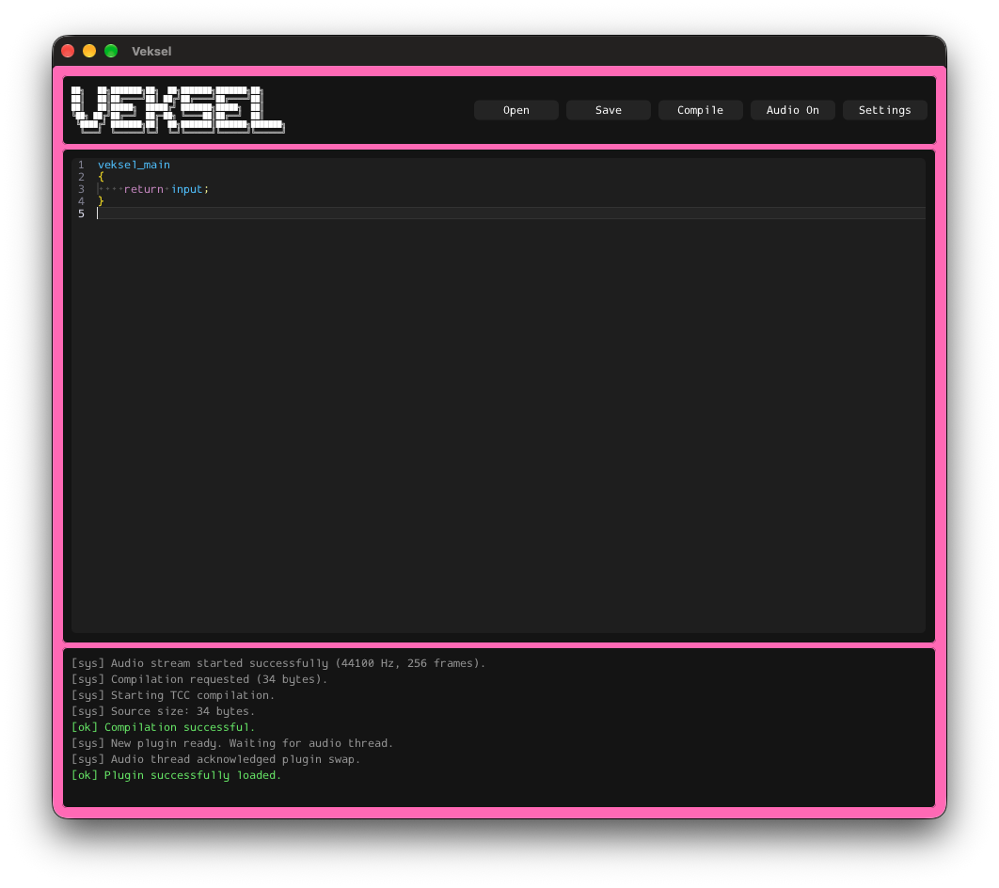

[](https://github.com/JoeKenyon/veksel/actions/workflows/main.yml)
# Veksel 

*Named after **Wechsel** (German for "change")*

Live-coded audio effects. Edit C in the window, press Compile, hear the change instantly.



## Building

```
git clone --recursive https://github.com/JoeKenyon/veksel
cd veksel
cmake -B build -DCMAKE_BUILD_TYPE=Release
cmake --build build
./build/veksel
```

You need CMake 3.16+, a C++20 compiler and `make`. Everything else (GLFW, PortAudio,
Dear ImGui, TinyCC, the text editor) comes in as submodules, so there's nothing to
install and no clang needed. TinyCC is what compiles your code.

Tests use Catch2, which CMake downloads at configure time:
```
ctest --test-dir build --output-on-failure
```

## Using it

Your code goes in the editor. Write a function with the `veksel_main` macro that
takes `input` (the current mic sample) and returns the output sample:
```
veksel_main
{
    return input * 0.5f;
}
```

Press **Compile** (or Cmd/Ctrl+R). If it builds, the new code is swapped into the
running stream. If it doesn't, the errors show in the log with line numbers that
match the editor, and the previous plugin keeps playing.
You get access to `<math.h>`, `<stdlib.h>`, `<stdio.h>` and `M_PI`.

The other buttons:

- **Open / Save**: type a path (relative to where you launched Veksel) and hit enter.
- **Audio On/Off**: stop and start the audio stream.
- **Settings**: input device and channel, output device and channel pair, sample
  rate and buffer size. Apply is greyed out until something changes, and if the
  new settings fail to open, the old ones are put back.

## How it works

Three threads, one job each:

- **main**: the ImGui window: editor, buttons, settings, log. It also installs new plugins, once per frame.
- **compiler**: TinyCC compiles your C straight into executable memory on its own thread, so the UI stays responsive while it builds.
- **audio**: PortAudio callback, runs the plugin once per sample.

The compiler thread hands the finished plugin to the main thread through a
mutex-guarded slot.

The main thread then asks the audio thread to stop using the current plugin and
waits for it to say it has. The audio thread answers at the next sample boundary,
so it can never be halfway through the old plugin. The main thread installs the
new plugin, frees the old one, and audio carries on.

The audio thread never locks, allocates, logs or frees memory.
For the moment of the swap, audio passes the input straight through.

## Rules for plugin code

`veksel_main` runs on the audio thread once per sample. Don't allocate, print,
lock, sleep or block. Keep it fast. Static variables work, but reset on every
reload.

## Limits

- Mono in, mono out (for now). One input channel is read, and the output sample is copied to both channels of the output pair you pick.
- A plugin that crashes (segfault) or never returns (infinite loop) takes the whole program down.
- Plugins don't know the sample rate.
- TinyCC doesn't optimise, so plugin code runs slower than it would from clang with `-O2`.
- Only tried on macOS (Apple Silicon). Linux is untested and Windows isn't supported yet.
- Your code isn't saved for you. It starts from a passthrough every launch, so use Save.

## TODO

- [ ] Survive a broken plugin: run a test in a new process before loading, and don't load if it breaks.
- [ ] Expose the sample rate to plugins.
- [ ] Stereo plugins (`veksel_main_stereo`).
- [ ] Make it cross platform